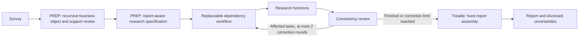

# PREP and dependency orchestration

Status: implemented as a selectable path, `market_research_next`. The current Castor
service and the existing `market_research` runner remain available unchanged. This
document records the solution, implementation plan, current contracts, and limits.
The recursive business-object builder is now connected to this selectable pipeline.
Live evaluation of the connected pipeline remains pending; see
[the test run guide](CONNECTED_PIPELINE_TEST.md).



## Decisions

- PREP interprets the venture before any research starts and maps its questions to the
  fixed report content.
- Code determines execution order, concurrency, and termination. Research workers can
  adapt their searches within a bounded tool budget.
- One initial execution permits at most two correction rounds across the entire report.
  A correction refreshes affected dependents, not just the paragraph where a problem appears.
- The scheduler is an implementation of a replaceable interface. Task contracts and
  Treadle report assembly do not depend on a particular scheduling strategy.
- Claim-to-external-source tracing is deferred and disabled. Existing source material,
  customer-input basis, and dependency fingerprints remain available; these are not a
  new source-auditing subsystem.

## Problem 1: survey to a venture object and research specification

The original survey is a record of the customer's answers, not a sufficiently detailed
research specification. A more capable model must interpret that record without turning
its guesses into customer statements.

`packs/market_research_next/prep.py:prepare_recursive` accepts a JSON brief and injectable
models. Inside the existing isolated PREP node, it builds and reviews the recursive
business object, then generates the report-aware specification from that accepted object.
The result uses `market_research.prep/2`. The standalone `prepare` function without an
object context remains available for earlier callers as version 1. The selectable
workflow requires version 2 at its task boundaries.
It returns:

| Field | Contract |
| --- | --- |
| `schema_version`, `prompt_version` | Versions of the artifact and its interpretation instructions |
| `input_fingerprint` | SHA-256 of canonical original input, for comparison and future resume support |
| `venture.customer_inputs` | A deep copy of the original survey/brief, including typed slots |
| `venture.attributes` | Product, target customer, buyer, user, problem, model, geography, stage, constraints, decision, price, operating cost, differentiation, alternatives |
| Attribute `basis` | `customer_stated`, `inferred`, or `unknown`, assigned by code |
| Attribute `source_fields` | Which supplied fields establish an answer; empty for model inference |
| `research_spec` | Scope, questions, assumptions to test, and required deliverables for every fixed report section |
| `business_context.object` | Full accepted business graph: organizational branches, offerings, actors, facts, qualifiers, relationships, and gaps |
| `business_context.statements`, `statement_paths` | Deterministic authoritative input records and their JSON paths; provisional intake is not promoted into stated input |
| `business_context.construction` | Actual construction call count, limits, completion/stop status, pending accepted branches, and excluded-record count |
| `business_context.readiness` | Recomputed per-section starting-input coverage and missing questions; never a claim that a finished report is ready |
| `research_spec.<section>.input_readiness` | The code-owned coverage record for that section |
| `source_tracing_enabled` | `false` in this version |

The application overlays supplied answers and explicit unknowns after validating model
output. Typed survey values remain intact: customer pricing and operating expenses cannot
be collapsed into a single number by this stage. Generated text is always inferred, even
if the model believes it extracted a statement from free prose. It cannot manufacture a
confirmed answer. Missing/extra section IDs, malformed JSON, and provider errors fail the
stage visibly. Research cannot start with an invalid PREP artifact.

Explicitly unconfirmed or reconstructed intake is also labeled inferred and cannot
overwrite direct customer statements. PREP can refine those provisional interpretations;
when it has no replacement, the earlier inference is retained. Confirmed intake may
refine direct statements;
customer-stated unknowns remain unknown. Missing answers in unconfirmed/reconstructed
intake cannot erase direct customer answers or become authoritative unknown statements.
Flag-less supplied intake retains the existing direct
input convention. The original record remains available for inspection in every case.
For additional structured fields such as locations, channels, and revenue streams,
the builder selects the authoritative whole field before extraction: explicit customer
unknowns take precedence; otherwise confirmed slots supersede confirmed facts and then
top-level values. The original survey remains an audit snapshot, including superseded
answers. Model instructions identify the selected source statements as the current scope.

The model is not selected by a hardcoded claim about which model is currently smartest.
The default `ExplicitPrepModel` adapter requires the operator to choose
`TREADLE_PREP_MODEL`; it calls that Anthropic model without switching to a weaker one.
Existing Anthropic credentials and paid-backend opt-in are respected. Another provider
can be supplied as a callable accepting `system=` and `user=` and returning a dict.
Research and report-writing models remain separately configurable through the existing
model layer or an injected research backend.

Business construction uses that same selected model by default, with a 12,000-token
response allowance; the specification call retains 7,000. A separate `business_model`
callable can be injected. Construction defaults to at most six calls, including one
reserved input-support review, and a maximum graph depth of six. The specification adds
one call. All calls consume the same PREP task and report-wide allowances; construction
does not create another report correction loop.

Only the accepted graph reaches the specification model, researchers, consistency
reviewer, and saved report. Candidate objects and quarantined claim text stay outside
this pipeline context; the number excluded is disclosed. The standalone experiment
runner remains available when full candidate/quarantine audit files are needed.
Support-review failure, malformed patches, or provider failure fail PREP visibly.
Reaching a construction call/depth limit can yield reviewed partial input; its pending
work and limitations remain explicit. Every researcher receives the full accepted graph,
so readiness projections do not discard extra locations, channels, or revenue streams.

Coverage guides research; a `needs_input` status does not automatically block a section
or ask the customer questions. These rules still have known semantic mapping limits.
Initial missing questions and construction limitations appear in the report, distinctly
from questions subsequently answered through research. This connection does not claim
that extraction is complete or that the live analysis is accurate.

PREP is the first node in the new dependency graph. Every research node requires its
output. This gives it the intended survey-to-research position while keeping scheduling
and error handling in one execution engine.

## Problem 2: execute dependencies and bounded corrections

The existing `Section` contract already declares a producer, its output key, required
inputs, optional inputs, applicability rules, and invariants. The new
`treadle/workflow.py` implements `Workflow.execute` over those same declarations.

| Component | Responsibility |
| --- | --- |
| `Section` | Work to perform and the artifacts it consumes/produces |
| `Workflow` | Replaceable execution interface |
| `DeterministicWorkflow` | Readiness, bounded concurrency, corrections, and termination |
| `ReviewIssue` | A specific problem and the section keys that need repair |
| `ExecutionResult` | Final verdicts, unresolved issues, correction count, and round history |
| `ExecutionLimits` | Finite report/task/review deadlines and shared model/tool call budgets |
| `TaskContract` | Input and output validators executed within the worker deadline |
| `ReportType.workflow` | Optional pack default |
| `run_report(..., workflow=...)` | Per-call strategy override |

The original serial path remains the default for existing sections packs. Legacy runner
packs own their execution and reject a workflow override rather than silently ignoring it.

The new scheduler:

1. Rejects duplicate producers, cycles, and collisions with caller-supplied values before
   starting work.
2. Starts ready tasks up to `max_workers`. A newly ready task can start while unrelated
   tasks are still running; execution does not wait for an entire layer to finish.
3. Gives each worker deep copies of only its declared inputs. Only the coordinator
   commits results to the shared FactStore.
4. Waits for optional producers to finish, but permits their absent output. Existing
   `optional` semantics are preserved; genuinely nonblocking contextual relationships
   can be added as a separate contract in a later version.
5. Validates inputs and outputs inside isolated processes. Malformed and invariant-flagged
   outputs cannot reach consumers. Records failures, skips, applicability decisions, and
   input fingerprints.
6. Runs whole-report review. Failed or flagged tasks automatically request repair;
   missing inputs are disclosed instead of repeatedly retried.
7. Invalidates repair roots and all transitive consumers, then reruns that subgraph.
   Successful unrelated outputs are retained. An obsolete result cannot survive a
   failed correction. Only values owned by this execution may be invalidated.
8. Stops after two correction rounds at most. Remaining issues are exposed and
   `Report.ok` is false. A reviewer failure is also an explicit unresolved issue.

The optional repair adapter supplies issue details to research functions during a
correction. The global cap governs report correction passes. A correction does not reset
the report deadline or call budgets. Timeout, exhausted calls, or failed review stops the
run with explicit unresolved issues; completed sections remain available for inspection.

### Closed-loop execution bounds

The selectable pack enables `ExecutionLimits()` by default:

| Limit | Default |
| --- | --- |
| Entire workflow, including corrections and review | 900 seconds |
| One task attempt, including recursive PREP and validation | 300 seconds |
| One consistency review | 90 seconds |
| Model attempts across the run | 120 |
| Agent tool dispatches across the run | 60 |
| Model / tool allowance for one task attempt | 12 / 8 |
| Model allowance for one review | 3 |

Tasks and reviews run in killable subprocess groups. The coordinator rejects late
results and terminates/reaps workers and their same-group children. Cleanup has a small
bounded overhead beyond the deadline. These limits cover workflow execution; CLI file
loading, report rendering, and optional PDF export happen outside it.

Before dispatch, the coordinator reserves a call allowance from the remaining global
budget. Workers gate each provider attempt, including retries and fallbacks, and each
agent tool dispatch. SDK retries are disabled within this scope. A completed valid usage
receipt refunds unused allowance; a crash or timeout conservatively charges the entire
reservation. `execution.usage.actual` includes observed receipts, while `charged` also
includes uncertain reservations. Neither counter is a token or dollar estimate. Per-attempt
`llm_usage` records available token usage; lost workers can leave that telemetry incomplete.
Reservations can temporarily reduce concurrency when the remaining allowance is small.

Tool dispatches are harness calls, not individual HTTP requests within a tool. A remote
request already accepted by a provider may still incur charges after the local worker
stops. Custom provider/tool adapters must use `charge_model_call()` or
`charge_tool_call()` immediately before dispatch to participate in call accounting.
Deadlines still apply to custom task code, including hung code.

Only finite JSON crosses the artifact boundary. The section contracts validate PREP's
version, input fingerprint, fixed deliverables, and research payload shapes. They do
not prove the truth of prose or replace the planned unit/currency/calculation checks.
Customer inputs cannot be replaced by a task output or invalidated during correction.

Worker inputs use [cloudpickle](https://github.com/cloudpipe/cloudpickle) to support
trusted local Python callables and closures; outputs use JSON. This is execution
isolation, not a sandbox for hostile Python code. Workers must have the same installed
code and Python environment. In-process mutable state is not shared with workers.
Progress callbacks are delivered after each round's research workers settle, so a slow
callback cannot delay another worker's deadline checks. They are isolated, have at most
one second and no call allowance, and cannot mutate the parent's in-memory progress list.
Their failures appear in
`execution.usage.progress_callbacks` without invalidating research.

The base `DeterministicWorkflow(limits=None)` retains the earlier thread-based behavior
for compatible callers. Explicit `build_report_type(limits=None)` opts out of the new
deadlines and boundary contracts; the selectable CLI always uses finite limits.
The base `ExecutionLimits()` retains its 180-second task default; this recursive pack
and its CLI select 300 seconds to accommodate object construction within PREP.

## Initial market-research dependency contracts

These contracts are the initial selectable implementation, not a claim of globally
optimal scheduling. The graph can change independently of report display order.
All research functions consume `prep` in addition to the inputs below.

| Output | Required research inputs | Purpose |
| --- | --- | --- |
| `competitive_landscape` | None | Direct competitors, indirect alternatives, status quo, comparison criteria |
| `customer_voice` | None | Available customer evidence, needs, objections, evidence gaps |
| `target_personas` | Customer voice | Proposed customer/buyer profiles and purchase criteria |
| `multi_perspective` | Target personas | Explicitly simulated analytical perspectives |
| `market_size` | Target personas | Market boundary, method, assumptions, TAM/SAM/SOM |
| `revenue` | Market size, competitive landscape | Pricing assumptions and three-year scenarios |
| `differentiators` | Competitive landscape, customer voice | Advantages tested against alternatives and needs |
| `summary` | All seven outputs are optional ordering dependencies | Synthesize completed analysis and disclose gaps |

The `LocalResearchBackend` uses existing bounded tool research for competitive landscape,
customer voice, and market size. Other tasks synthesize PREP and declared upstream
results. Every task receives its actual PREP questions; they are not merely stored beside
an unchanged prompt. A backend can be replaced by another callable with the same inputs
and output shape.

The default backend uses an explicit tool allowlist: public search, archived pages,
community APIs, and geographic/economic datasets. Legacy browser fetching, Trustpilot's
browser fallback, and composite firmographic enrichment are excluded pending hardening.
This limits coverage in the selectable path; adding a tool to the shared registry does
not automatically expose it here.

Tool failures, empty retrieval, and transform-only results cannot count as successful
external research. Partial work is disclosed. Simulation is labeled in the output by
code. The final section contract includes title, narrative, findings, assumptions,
uncertainties, and optional structured metrics. HTML/PDF assembly uses a fixed section
order, preserves metrics, and escapes all supplied text.

The default whole-report reviewer checks internal contradictions, scope, units, periods,
and arithmetic. It does not audit claims against external sources. Per-section code
checks enforce shapes and execution consistency; specialized deterministic numerical
models and validators from the existing Castor pipeline are not yet ported to this pack.

## Implementation plan and acceptance

| Step | Implementation | Acceptance |
| --- | --- | --- |
| 1. PREP contract | `packs/market_research_next/prep.py`, `models.py` | Preserve answers/unknowns/typed slots; reject invalid model output; cover every report section |
| 2. Execution engine | `treadle/workflow.py` | Real concurrency, dependency readiness, worker isolation, stable verdict ordering |
| 3. Correction controller | Same executor plus pack reviewer/repair adapter | Global two-round cap; downstream invalidation; unrelated outputs reused; unresolved issues retained |
| 4. Selectable integration | `ReportType.workflow`, `run_report`, new pack | Existing runner unchanged; explicit model/agent/scheduler substitution |
| 5. Delivery | Pack renderer and `scripts/treadle_market_research.py` | JSON + HTML, optional PDF; fixed report order; limitations and metrics visible |
| 6. Validation | New offline unit/integration tests and existing Treadle/legacy regression suites | Models/tools mocked; no provider charges; production boundaries preserved |

These steps are implemented. Tests exercise behavior, including real subprocess overlap,
hung-task termination, call accounting, contract rejection, and targeted corrections,
with fake external observations/models. They do not establish
the quality of a live market-research report.

Before making this the default customer path, compare representative ventures against
the existing pipeline on relevance, unsupported assumptions, consistency, missing
sections, time, and cost. Port additional Castor calculations and domain-specific behavior
where they improve those outcomes. The selectable path is not feature-parity with the
existing ~25-stage Castor pipeline and does not replace its service routes or UI.

## Use

Inspect without any model or network calls:

```sh
.venv/bin/python -m pip install -e .
.venv/bin/python scripts/treadle_market_research.py --describe
```

After choosing a PREP model and configuring the existing research providers:

```sh
export TREADLE_PREP_MODEL='your-selected-model-id'
# Configure ANTHROPIC_API_KEY and the existing paid-backend opt-in outside source files.
.venv/bin/python scripts/treadle_market_research.py \
  --brief docs/treadle/example_venture.json --out out/venture-next --pdf \
  --workers 4 --correction-rounds 2 \
  --run-timeout 900 --task-timeout 300 --review-timeout 90 \
  --model-calls 120 --tool-calls 60 --business-calls 6 --business-depth 6
```

The command saves JSON and HTML even when research remains incomplete, with a nonzero
exit status. PDF uses the existing exporter and requires its installed rendering engine.
The example is fictional input, not a researched business or a quality benchmark.

To supply different models/agents:

```python
from treadle import register, run_report
from packs.market_research_next import build_report_type

register(build_report_type(
    key="my_venture_report",
    prep_model=my_preparation_model,  # callable(system=..., user=...) -> dict
    business_model=my_object_model,  # same callable protocol; expansion/review schemas
    research=my_research_function,   # callable(section_key, context, issues=()) -> dict
    review=my_consistency_reviewer,  # callable(result, verdicts) -> sequence[ReviewIssue]
))
report = run_report("my_venture_report", survey_brief)
```

## Evolution boundaries

More advanced scheduling can implement the same `Workflow` interface: distributed
workers, resource-aware limits, prioritization, or a model-proposed plan validated by
code. More agents do not require changing Treadle's report contract. A later source
tracing module can link findings and claims to evidence without replacing this pipeline.

Durable mid-run checkpoints/resume, provider-wide concurrency limits, automatic PREP
reuse, and adaptive task creation are not implemented in this version. The stored
fingerprints and execution history are useful foundations, not claims that these
features already exist. The isolated selectable path enforces local worker deadlines;
distributed cancellation and provider-side request cancellation are separate future work.
Provider pacing currently remains local to each worker; simultaneous sections can still
encounter provider throttling even when within their call allowances. Callable
serialization, graph setup, and coordinator mapping operations use trusted local code
and are not independently sandboxed or forcibly interrupted by a worker deadline.
